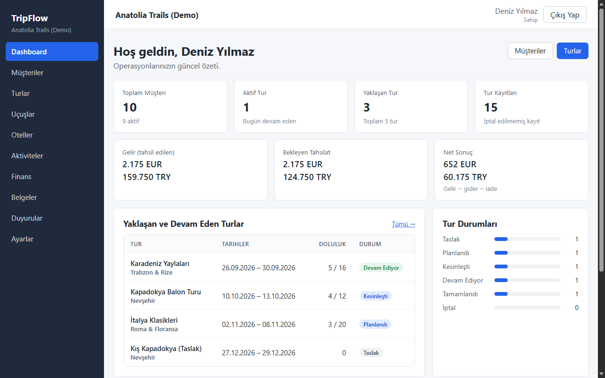
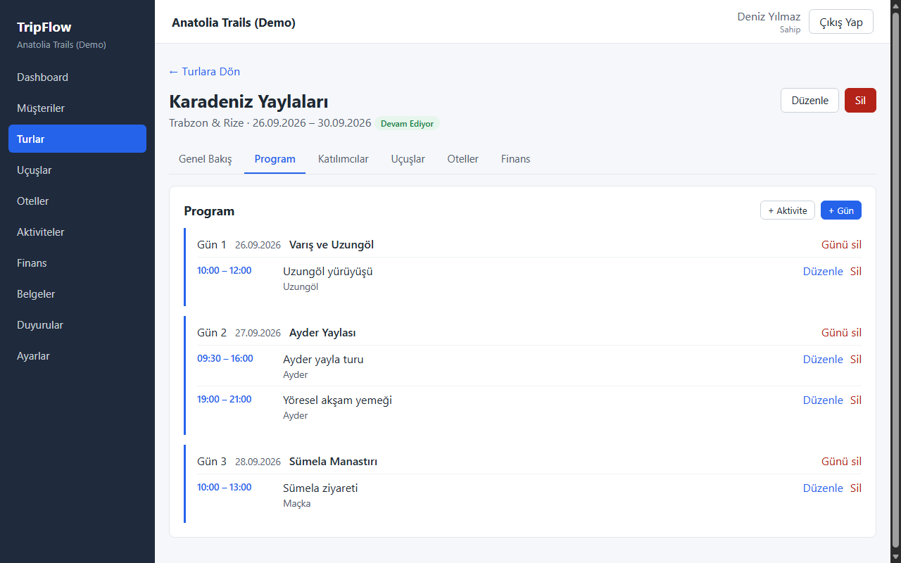
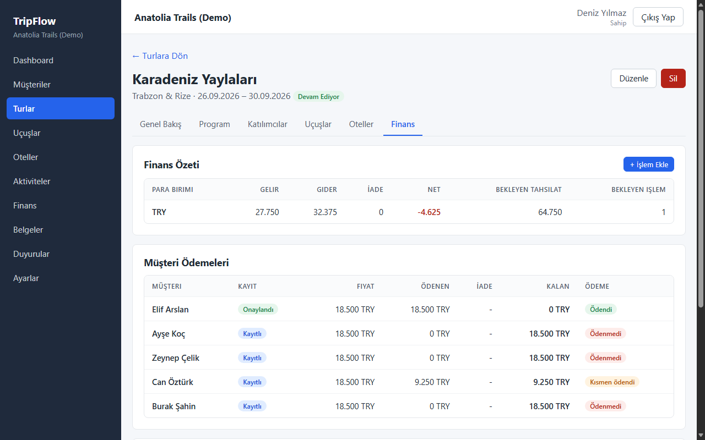
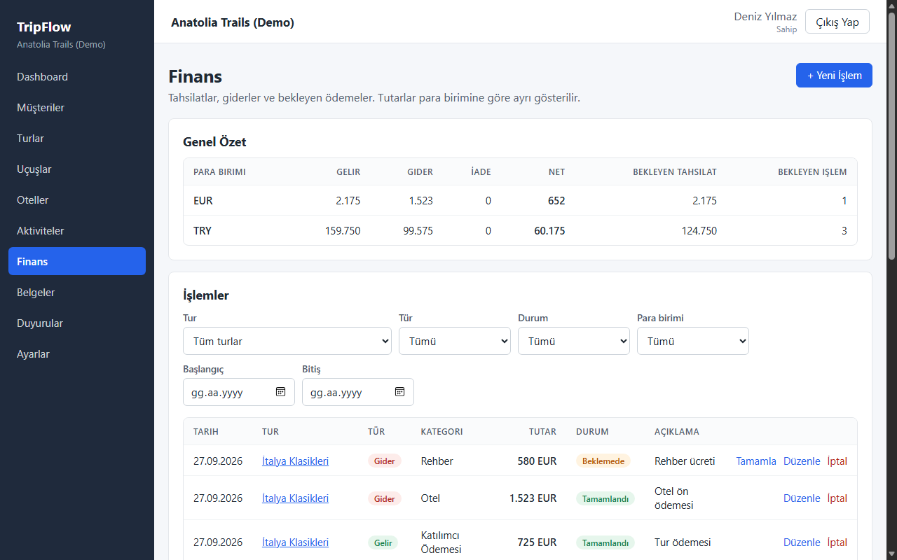
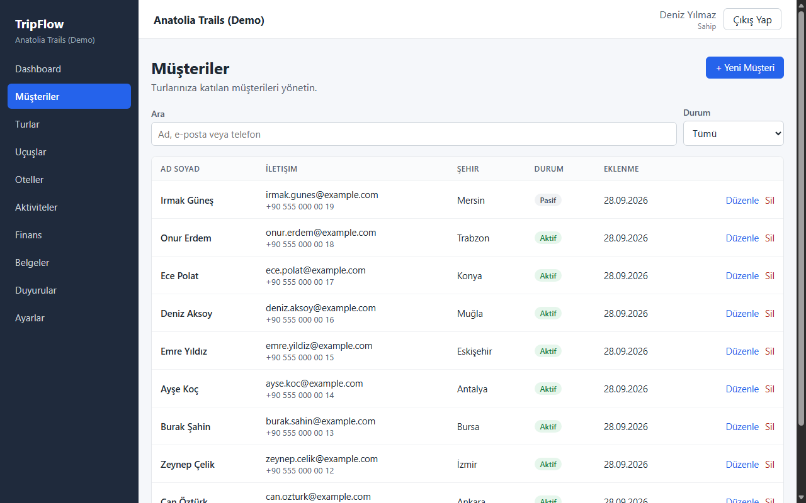
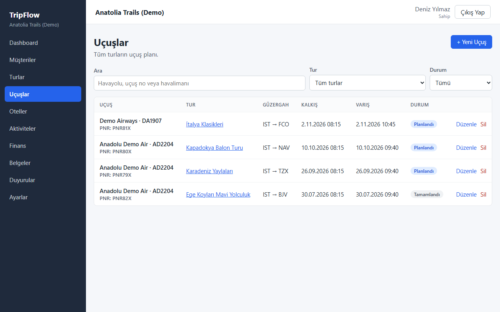
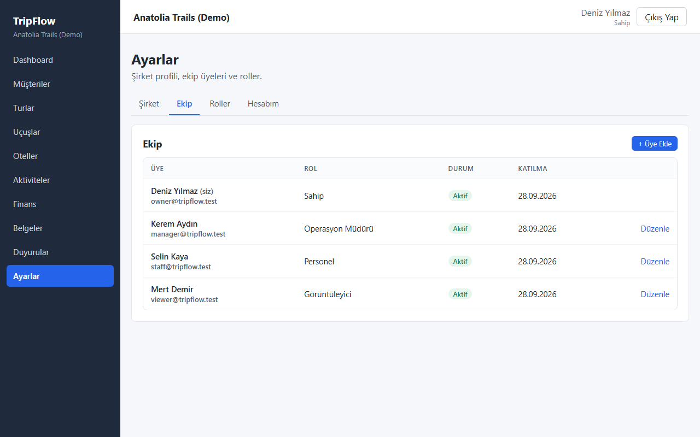
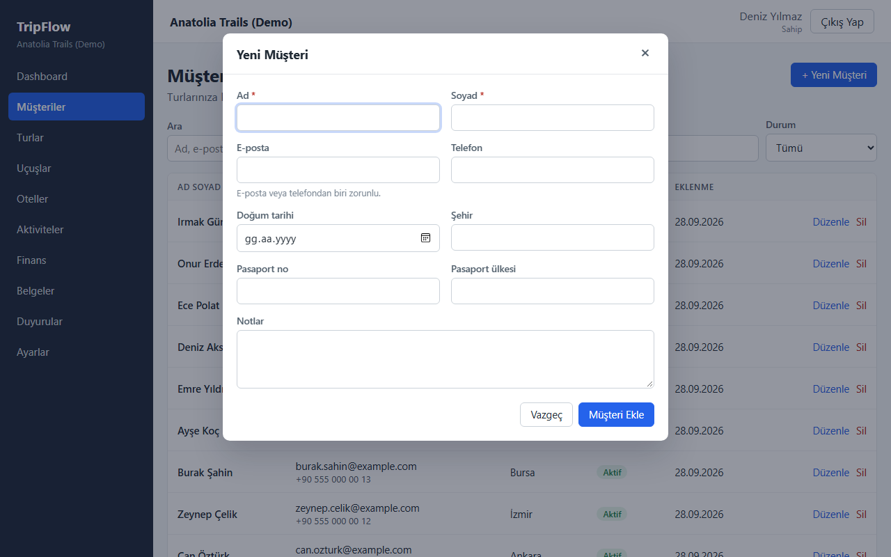
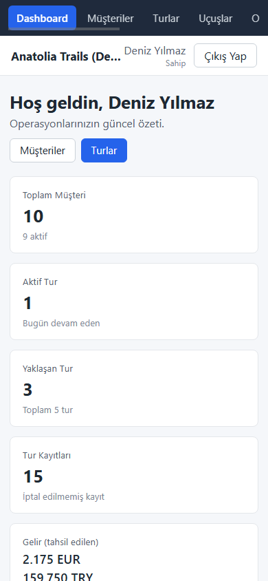

# TripFlow

**TripFlow is a multi-tenant operations platform for tour operators and travel agencies.**
One place to run a group tour end to end: customers, tours and their day-by-day program,
flights, hotels, documents, announcements, and the money — who owes what, what was paid,
and how each tour is doing financially.

Built as a full-stack portfolio project with a production-minded backend: company-level
data isolation, permission-based access control, database-enforced integrity rules and
an integration test suite that runs against a real PostgreSQL database.



---

## Features

**Operations**
- **Customers** — searchable customer records with contact/passport details and the tours each customer is on.
- **Tours** — create, schedule and track tours through their lifecycle (`DRAFT → PLANNED → CONFIRMED → ONGOING → COMPLETED / CANCELLED`), with capacity tracking.
- **Registrations** — add customers to tours with a sale price, room number and special requests.
- **Day-by-day program** — tour days with timed activities.
- **Flights & hotels** — bookings per tour (PNR, terminals, check-in/out), plus company-wide lists.
- **Documents** — metadata and links for passports, tickets, visas, programs, with per-document visibility.
- **Announcements** — draft → publish workflow, per tour, with read tracking.

**Finance**
- Payments, expenses and refunds as an append-only ledger (records are cancelled, never deleted).
- Per-customer **price / paid / remaining**, and payment status (`UNPAID → PARTIALLY_PAID → PAID / REFUNDED`) derived automatically from completed payments.
- Per-tour and company-wide totals **per currency** (TRY / EUR / USD / GBP) — amounts in different currencies are never mixed or silently converted.

**Platform**
- **Dashboard** with live metrics: customers, active/upcoming tours, registrations, revenue, outstanding payments and net result.
- **Multi-tenancy** — every company's data is isolated; users only ever see their own company.
- **Roles & permissions** — `OWNER`, `ADMIN`, `MANAGER`, `STAFF`, `VIEWER` plus custom roles, built on 44 permission keys.
- **Team management** — invite existing accounts by email, change roles, deactivate members — with privilege-escalation protection.
- **Onboarding** — register with a company in one step, or create one later.
- **Participant self-service API** (`/api/me/...`) — a customer linked to a user account can read their own program, flights, hotels, documents and payments.

## Tech Stack

| Layer | Technology |
|---|---|
| Frontend | React 19, React Router 7, Vite, Axios, plain CSS (no UI framework) |
| Backend | Node.js 22, Express 5, `pg` (node-postgres), JWT (`jsonwebtoken`), `bcryptjs` |
| Database | PostgreSQL (developed on 18) with SQL migrations |
| Testing | Node's built-in test runner (`node --test`) against a real test database; headless-browser QA |
| Tooling | oxlint, nodemon |

**Why these choices**
- **PostgreSQL** — the domain is relational through and through (company → tour → registrations → payments). Foreign keys, `CHECK` constraints, partial unique indexes and triggers enforce the business rules *in the database*, so no code path can bypass them.
- **Raw, parameterized SQL (no ORM)** — every query is visible and reviewable, and every value goes through `$1`-style parameters.
- **JWT** — stateless auth that fits a SPA + REST API; each request re-validates the user and re-resolves their company membership and permissions from the database, so revoking access takes effect immediately.
- **React + Vite, no UI kit** — a small, dependency-light frontend; a handful of shared primitives (modal, table, badges, form fields) keep the UI consistent.

## Architecture

```
frontend (React SPA)                    backend (Express REST API)                    PostgreSQL
─────────────────────                   ─────────────────────────────────             ──────────────
pages/ ── components/ ── hooks/         routes/ ─▶ middleware chain ─▶ controllers ─▶ services ─▶  tables, FKs,
   │                                               auth → company → owner → perm        │         CHECKs, triggers
   └── services/apiClient (Axios, JWT) ──HTTP──▶                                        └── utils (validation,
       context/Auth (user, company, permissions)                                             errors, pagination)
```

Every business request passes the same middleware chain:

1. **`authMiddleware`** — verifies the JWT and loads the user (401 otherwise).
2. **`requireCompanyMembership`** — resolves the company from the caller's *own* active membership (or an `X-Company-Id` header that must match a membership); a client can never pick someone else's company.
3. **`requireResourceOwnership`** — for `/:id` routes, checks that the resource belongs to that company. Another company's resource is a **404**, indistinguishable from a missing one, so ids can't be probed. Malformed ids (`abc`, `1.5`, out of INTEGER range) are a **400**.
4. **`requirePermission("…")`** — checks the member's role grants the permission key (403 otherwise).

Steps 3 and 4 run in either order depending on the route, but both always run.

Services contain the SQL; controllers stay thin; a central error handler turns known errors into a JSON envelope and never leaks stack traces or SQL. The business API uses the envelope below; the older auth endpoints (`/users`, `/users/login`, `/users/me`) and the auth middleware's 401 still use a flat `{ "success": false, "message": "…" }` shape, which the frontend handles as well.

```jsonc
// success                                  // error
{ "success": true, "data": { … } }          { "success": false, "error": { "code": "VALIDATION_ERROR", "message": "…" } }
{ "success": true, "data": [ … ], "pagination": { "page": 1, "limit": 20, "total": 57, "totalPages": 3 } }
```

## Database

Schema is built by 15 ordered, idempotent SQL migrations (`backend/database/migrations`). Migration 001 captures the original prototype schema (`users`, `trips`, `trip_days`, `activities`); its legacy `/api/trips` endpoints are kept for backward compatibility, while the business API below is the current model.

| Area | Tables |
|---|---|
| Tenancy & access | `companies`, `users`, `company_users`, `roles`, `permissions`, `role_permissions` |
| Operations | `tours`, `participants`, `tour_participants`, `tour_days`, `activities` |
| Travel | `flights`, `flight_participants`, `hotels`, `hotel_rooms`, `hotel_room_participants` |
| Communication | `announcements`, `announcement_reads`, `documents` |
| Finance | `finance_transactions` (+ price/payment columns on `tour_participants`) |

Integrity rules live in the database, not just the API:
- Tenant boundaries on every relation: a registration, payment, document or room assignment can only link records **of the same company and tour** (enforced by triggers).
- `CHECK` constraints for every status/enum, date order (`end_date >= start_date`, `arrival > departure`), positive amounts, valid type/category pairs in finance.
- Unique rules: one registration per customer per tour, one day number per tour, case-insensitive unique emails, per-company unique payment reference numbers.
- Finance records are `ON DELETE RESTRICT` — a tour with money movements can't be deleted by accident.

## Authentication

- `POST /api/users` (register — optionally with `companyName`, creating the company and OWNER membership in one transaction) and `POST /api/users/login` return a JWT.
- Passwords are hashed with bcrypt and never returned by any endpoint; emails are normalized and unique case-insensitively.
- Login errors don't reveal whether an account exists; login and registration are rate-limited per IP/email.
- The frontend stores the token, attaches it to every request, and on any `401` signs the user out and shows a "session expired" notice.

## Authorization

| Role | Summary |
|---|---|
| **OWNER** | Everything. |
| **ADMIN** | Everything except deleting the company. |
| **MANAGER** | Full operational CRUD and finance (no finance deletion, no team/role management). |
| **STAFF** | Mostly read-only (including finance totals); adds/edits activities and updates registrations. Cannot change prices or payment status (needs `finance.update`). |
| **VIEWER** | Read-only operations. **No finance data at all**: sale prices and payment status are stripped from API responses, not merely hidden in the UI. |

Custom roles can be composed from the permission keys, with a *privilege ceiling*: nobody can grant a permission — or assign a role — beyond their own, and nobody can modify a member who outranks them or their own membership.

## API

Base URL: `http://localhost:5000/api`. All business endpoints require `Authorization: Bearer <token>`.
List endpoints accept `page` / `limit` (max 100) and validate every filter (bad input is a `400`, never a `500`).

| Resource | Endpoints |
|---|---|
| Auth | `POST /users` · `POST /users/login` · `GET /users/me` |
| Company | `POST /companies` · `GET/PATCH /companies/me` · `GET /companies/me/permissions` |
| Team & roles | `GET/POST /company-users` · `GET/PATCH /company-users/:id` · `GET/POST /roles` · `GET/PATCH /roles/:id` · `GET/PUT /roles/:id/permissions` |
| Customers | `GET/POST /participants` (`search`, `status`) · `GET/PATCH/DELETE /participants/:id` · `GET /participants/:id/tours` |
| Tours | `GET/POST /tours` (`search`, `status`, `startFrom`, `startTo`) · `GET/PATCH/DELETE /tours/:id` |
| Registrations | `GET/POST /tours/:id/participants` · `PATCH/DELETE /tours/:id/participants/:participantId` |
| Program | `GET/POST /tours/:id/days` · `GET/PATCH/DELETE /tours/:id/days/:dayId` · `GET/POST /tour-days/:dayId/activities` · `GET /activities` · `PATCH/DELETE /activities/:id` |
| Flights | `GET /flights` · `GET/POST /tours/:id/flights` · `GET/PATCH/DELETE /flights/:id` · passengers: `/flights/:id/participants[/:participantId]` |
| Hotels | `GET /hotels` · `GET/POST /tours/:id/hotels` · `GET/PATCH/DELETE /hotels/:id` · rooms: `/hotels/:id/rooms`, `/hotel-rooms/:id[/participants]` |
| Documents | `GET /documents` · `GET/POST /tours/:id/documents` · `GET/PATCH/DELETE /documents/:id` |
| Announcements | `GET /announcements` · `GET/POST /tours/:id/announcements` · `GET/PATCH/DELETE /announcements/:id` · `PATCH /announcements/:id/publish` · `GET /announcements/unread` · `POST /announcements/:id/read` |
| Finance | `GET /finance/summary` · `GET /finance/transactions` · `GET/POST /tours/:id/finance` · `GET /tours/:id/finance/summary` · `GET/PATCH /finance/transactions/:id` · `PATCH /finance/transactions/:id/cancel` |
| Dashboard | `GET /dashboard/summary` |
| Self-service | `GET /me/tours` · `GET /me/tours/:tourId/{program,flights,hotels,announcements,documents,payments}` |

## Installation

Prerequisites: **Node.js 22+** and **PostgreSQL 14+**.

```bash
git clone <your-fork-url> tripflow && cd tripflow

# databases
createdb tripflow_db
createdb tripflow_test

# backend
cd backend
cp .env.example .env              # fill in DB_* (or DATABASE_URL) and JWT_SECRET
cp .env.test.example .env.test    # DB_NAME=tripflow_test, a different JWT_SECRET
npm install
npm run migrate                   # applies database/migrations/*.sql
npm run seed:demo                 # optional: fictional demo company

# frontend
cd ../frontend
cp .env.example .env              # VITE_API_URL=http://localhost:5000/api
npm install
```

## Environment Variables

**backend/.env**

| Variable | Description |
|---|---|
| `PORT` | API port (default `5000`). |
| `NODE_ENV` | `development` / `production` / `test`. |
| `CLIENT_URL` | Allowed CORS origin(s), comma-separated (default `http://localhost:5173`). |
| `DATABASE_URL` | Optional Postgres connection string; takes precedence over `DB_*`. |
| `DB_HOST`, `DB_PORT`, `DB_NAME`, `DB_USER`, `DB_PASSWORD` | Discrete connection settings. |
| `JWT_SECRET` | Signing secret. Required; must be ≥ 32 characters when `NODE_ENV=production`. |
| `JWT_EXPIRES_IN` | Token lifetime (default `7d`). |

**frontend/.env**

| Variable | Description |
|---|---|
| `VITE_API_URL` | API base URL, e.g. `http://localhost:5000/api`. |

## Running Locally

```bash
# terminal 1
cd backend && npm run dev          # http://localhost:5000  (GET /api/health)

# terminal 2
cd frontend && npm run dev         # http://localhost:5173
```

**Demo accounts** (after `npm run seed:demo`; all data is fictional, password `Demo1234!`):

| Role | Email |
|---|---|
| OWNER | `owner@tripflow.test` |
| MANAGER | `manager@tripflow.test` |
| STAFF | `staff@tripflow.test` |
| VIEWER | `viewer@tripflow.test` |

`npm run seed:demo -- --reset` recreates the demo company (it only ever touches the demo company and demo accounts). The seed refuses to run with `NODE_ENV=production`.

## Testing

```bash
cd backend
npm test        # migrates tripflow_test, then runs the whole suite
```

- **120 tests / 23 suites** — authentication, onboarding, RBAC privilege ceiling, **company isolation across every resource type**, the VIEWER role, team management, finance hardening (field-level permissions, response filtering, query/id validation, sort stability), end-to-end business flows for every module, finance math and payment-status derivation, dashboard metrics, rate limiting.
- Tests hit the **real app over HTTP** against a **real PostgreSQL database** — no mocks. A guard refuses to run unless the database is literally named `tripflow_test`, and every test cleans up the data it created.
- The frontend is checked with `npm run build` and `npm run lint` (oxlint, zero warnings), and the main user journey (register → customers → tour → registration → flight → hotel → program → payment → dashboard → logout/login, plus viewer, cross-company, invalid-token and mobile-layout checks) was exercised in headless Microsoft Edge.

## Screenshots

| | |
|---|---|
|  |  |
| **Tour program** — days and timed activities | **Tour finance** — per-customer price / paid / remaining |
|  |  |
| **Finance** — per-currency totals and ledger | **Customers** — search and status filter |
|  |  |
| **Flights** across all tours | **Team** management with roles |
|  |  |
| Forms with validation | Responsive layout |

## Future Improvements

- **File storage** — documents currently store a link; direct uploads (S3-compatible storage with signed URLs) would complete the module.
- **Participant portal UI** — the self-service API exists; a customer-facing frontend is not built yet.
- **Company switcher** — the API supports multi-company users via `X-Company-Id`; the UI assumes one company per user.
- **Refresh tokens / server-side session revocation** — access tokens are long-lived JWTs (7 days).
- **Shared rate-limit store** (Redis) for multi-instance deployments; `app.set("trust proxy")` behind a reverse proxy.
- **Flight/hotel passenger assignment UI** — supported by the API, not yet exposed in the frontend.
- **Reports & exports** (CSV/PDF), audit log, email notifications for announcements.
- **Frontend unit/component tests** and CI (GitHub Actions running `npm test` against a Postgres service container).
- **i18n** — the UI is Turkish; the codebase and API are ready for translations.

## Project Structure

```
tripflow/
├── backend/
│   ├── database/
│   │   ├── migrate.js              # ordered, transactional migration runner
│   │   ├── migrations/             # 001 … 015 SQL migrations
│   │   └── seeds/demo.js           # fictional demo company (npm run seed:demo)
│   ├── src/
│   │   ├── app.js / server.js      # Express app, CORS, routing, startup checks
│   │   ├── config/db.js            # pg pool (DATABASE_URL or DB_*)
│   │   ├── middleware/             # auth, company membership, permissions, id validation, rate limit, errors
│   │   ├── routes/                 # one router per resource
│   │   ├── controllers/            # thin HTTP layer
│   │   ├── services/               # SQL + business rules (finance summaries, dashboard, ...)
│   │   └── utils/                  # validation, pagination, response envelope, DB error mapping
│   └── tests/
│       ├── helpers/                # test DB guard, real HTTP server, fixtures, scenario builder
│       ├── security/               # auth, RBAC, tenancy, finance hardening, rate limit
│       └── business/               # announcements, end-to-end operations
├── frontend/
│   └── src/
│       ├── pages/                  # Dashboard, Customers, Tours, TourDetail, Flights, Hotels, ...
│       ├── components/             # layout, tour sections, finance tables, forms/, ui/ primitives
│       ├── context/                # auth (user, company, permissions), toasts
│       ├── hooks/                  # useApi, useListFilters, useSubmit, ...
│       ├── services/apiClient.js   # Axios instance: base URL, JWT, 401 handling
│       └── utils/                  # labels, dates, money, API error messages
└── docs/screenshots/
```

## License

Portfolio project — all rights reserved by the author unless a license file is added.
